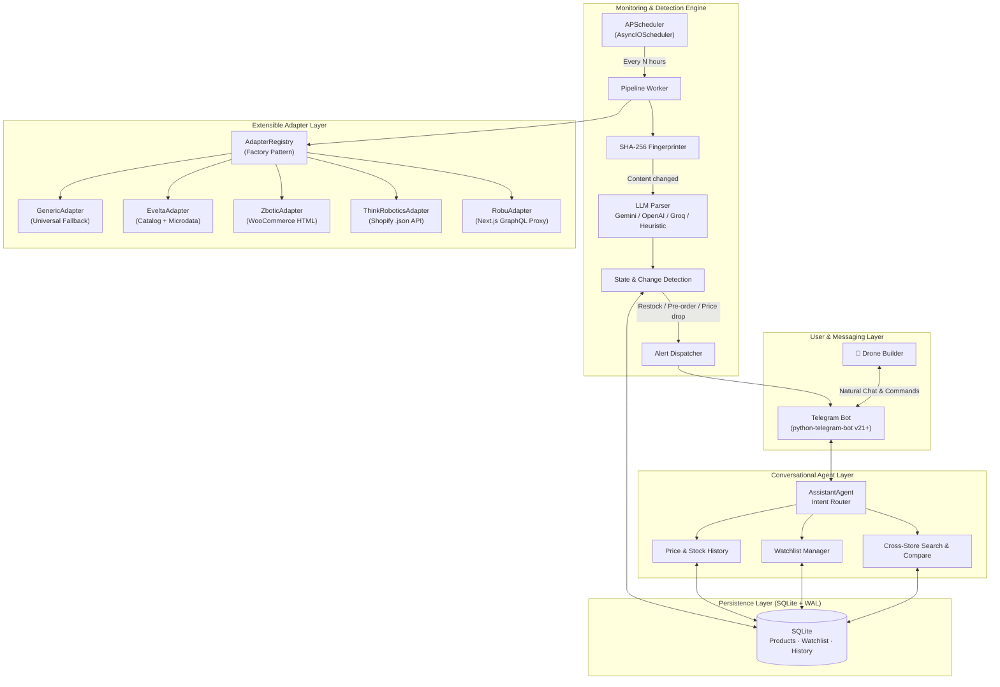

# 🚁 DronePartAssistant — AI-Powered Stock Monitor for Indian Drone Parts

> A production-grade Telegram bot that monitors Indian drone/robotics retailers for **stock changes**, **pre-order openings**, and **price drops** — and alerts you instantly. Includes a fully conversational AI agent you can chat with to search, compare, and manage a watchlist.

[](https://www.python.org/)
[](https://python-telegram-bot.org/)
[](https://www.sqlite.org/)
[](LICENSE)

---

## Table of Contents

1. [Features](#1-features)
2. [System Architecture](#2-system-architecture)
3. [Project Structure](#3-project-structure)
4. [Design Decisions & Trade-offs](#4-design-decisions--trade-offs)
5. [Setup & Quickstart](#5-setup--quickstart)
6. [Configuration Reference](#6-configuration-reference)
7. [CLI Usage](#7-cli-usage)
8. [Telegram Bot Commands](#8-telegram-bot-commands)
9. [Extending: Add a New Retailer](#9-extending-add-a-new-retailer)
10. [Running Tests](#10-running-tests)
11. [Known Limitations & Roadmap](#11-known-limitations--roadmap)

---

## 1. Features

| Feature | Details |
|---|---|
| 🔍 **Multi-store search** | Searches Robu.in, ThinkRobotics, Zbotic, Evelta concurrently |
| 📦 **Stock monitoring** | Detects `OUT_OF_STOCK → IN_STOCK`, `→ PRE_ORDER` transitions |
| 💸 **Price drop alerts** | Configurable price-drop threshold with alert cooldown |
| 🤖 **Conversational AI agent** | Natural language interface: "Is Pixhawk 6X in stock?" |
| 🛡️ **Anti-bot bypass** | TLS fingerprint impersonation via `curl_cffi` |
| ⚡ **Cost-optimised LLM** | SHA-256 content hashing skips redundant API calls |
| 🔌 **LLM-agnostic** | Supports Gemini, OpenAI, Groq, or offline heuristic fallback |
| 🗄️ **Zero-ops database** | SQLite with WAL mode — no server setup required |
| 🧪 **Fully tested** | 7 async unit tests with `pytest-asyncio` |

---

## 2. System Architecture



### Request Flow: "Is Pixhawk 6X in stock?"

```
User → Telegram → TelegramBotService
    → AssistantAgent.handle_message()
        → LLM routes intent → search_products_tool("Pixhawk 6X")
            → AdapterRegistry.search_all()
                → RobuAdapter.search()         ┐
                → ThinkRoboticsAdapter.search() ├─ concurrent (asyncio.gather)
                → ZboticAdapter.search()       ┘
            → merged List[Dict] results
        → formatted reply text
    → Telegram sends message to user
```

### Background Monitoring Flow

```
APScheduler (every 24h)
    → MonitoringEngine.run_monitoring_cycle()
        → for each Product in DB:
            → fetch page via correct adapter
            → clean HTML  →  SHA-256 hash
            → hash == stored hash?  →  SKIP (no LLM call)
            → else: parse_product_with_llm()
            → compare new_status vs last_status
            → if changed: _dispatch_alert() → Telegram
            → append ProductHistory row
            → update Product row
```

---

## 3. Project Structure

```text
DronePartAssistant/
├── src/
│   ├── adapters/
│   │   ├── base.py            # BaseScraperAdapter (ABC) + curl_cffi TLS client
│   │   ├── robu.py            # Robu.in — Next.js internal GraphQL proxy
│   │   ├── thinkrobotics.py   # ThinkRobotics — Shopify .json + suggest API
│   │   ├── zbotic.py          # Zbotic — WooCommerce HTML scraping
│   │   ├── evelta.py          # Evelta — catalog HTML + safari TLS profile
│   │   ├── generic.py         # GenericAdapter — universal fallback
│   │   └── registry.py        # Factory resolver + concurrent search_all()
│   ├── bot/
│   │   ├── assistant_agent.py # Conversational AI agent (6 tool methods)
│   │   └── telegram_bot.py    # Telegram handlers, _safe_reply(), alert sender
│   ├── core/
│   │   ├── config.py          # Pydantic Settings — loads from .env
│   │   ├── database.py        # Async SQLAlchemy engine, WAL mode, seeder
│   │   └── models.py          # ORM models: Product, Retailer, WatchlistItem,
│   │                          #             ProductHistory, StockStatus enum
│   ├── extractor/
│   │   ├── html_cleaner.py    # DOM stripper, JSON-LD extractor, SHA-256 hasher
│   │   ├── llm_parser.py      # Gemini/OpenAI/Groq parser + heuristic fallback
│   │   └── schemas.py         # Pydantic ProductExtractionResult schema
│   ├── scheduler/
│   │   └── engine.py          # MonitoringEngine: state machine, cooldowns,
│   │                          #                   APScheduler integration
│   └── main.py                # CLI entry point (argparse + asyncio.run)
├── tests/
│   ├── test_adapters.py        # RobuAdapter, ThinkRoboticsAdapter
│   ├── test_html_cleaner.py    # DOM cleaning, SHA-256 determinism
│   ├── test_assistant_agent.py # Intent routing, tool dispatch
│   └── test_state_engine.py    # No-change skip, status transition, alert dispatch
├── seed_data.json              # 6 curated product URLs (Pixhawk, RPi5, FC, etc.)
├── requirements.txt
├── pytest.ini
├── .env.example                # Configuration template — copy to .env
└── README.md
```

---

## 4. Design Decisions & Trade-offs

### A. Web Scraping — `curl_cffi` over Playwright

**Problem:** Target retailers run behind Cloudflare WAF. Standard `requests`/`httpx` receive `403 Forbidden` (`cf-mitigated: challenge`).

**Solution:** TLS/JA3 fingerprint impersonation via `curl_cffi`:

```python
from curl_cffi.requests import AsyncSession
async with AsyncSession(impersonate="chrome120") as session:
    response = await session.get(url)
```

- Evelta.com requires `impersonate="safari15_5"` (chrome120 gives 403).
- Robu.in's internal **Apollo GraphQL proxy** (`/api/proxy/graphql/`) was reverse-engineered from DevTools — returns exact stock counts in `< 200ms`.
- ThinkRobotics uses Shopify's native `.json` endpoint — zero scraping needed.

**Trade-off vs Playwright:** `curl_cffi` uses `< 30 MB RAM` and responds in `< 400ms`. A Playwright browser instance uses `~200 MB RAM` and takes `5–10s` per page. We use `curl_cffi` for all supported adapters and fall back to `GenericAdapter + LLM` for unknown stores.

---

### B. LLM Usage — Where, Why & Cost Control

**Model choices:** `gemini-1.5-flash`, `gpt-4o-mini`, Groq `llama-3.1-8b-instant` (all small/cheap).

| Use case | LLM used? | Reason |
|---|---|---|
| Known retailer product page | ❌ No | Direct API / JSON-LD |
| Unknown/generic store page | ✅ Yes | HTML → structured JSON extraction |
| Conversational intent routing | ✅ Yes | Free-form NL → tool call |
| Page unchanged (hash match) | ❌ Skipped | SHA-256 fingerprint check |
| No API key configured | ❌ No | Heuristic regex + BeautifulSoup |

**SHA-256 hash guard:**
```python
current_hash = hashlib.sha256(cleaned_text.encode()).hexdigest()
if current_hash == product.content_hash:
    return  # skip LLM — page hasn't changed
```
On stable product pages this results in ~0 LLM calls per day.

---

### C. State & Change Detection

**Stock status states:** `IN_STOCK` · `OUT_OF_STOCK` · `PRE_ORDER` · `DISCONTINUED` · `UNKNOWN`

**Alert-triggering transitions:**
- `OUT_OF_STOCK → IN_STOCK` — primary restock alert
- `OUT_OF_STOCK → PRE_ORDER` — pre-order opening with ETA
- `UNKNOWN → IN_STOCK` — new product discovered
- Price drop `> 2%` on any watchlisted item

**Alert cooldown** (`ALERT_COOLDOWN_HOURS=6`) prevents duplicate alerts from retailer glitches. Every check is persisted to `ProductHistory` for trend analysis.

---

### D. Database — SQLite with WAL Mode

**Why SQLite:** Zero-ops for a single-user bot. No server, no auth, no backups — just a file.

**Why WAL mode:**
```python
@event.listens_for(engine.sync_engine, "connect")
def set_wal_mode(dbapi_conn, _):
    dbapi_conn.execute("PRAGMA journal_mode=WAL")
```
WAL (Write-Ahead Logging) allows simultaneous reads and writes — needed because APScheduler (background) and the Telegram async handler both access the DB concurrently.

**Scale-up path:** Swap `DATABASE_URL` to `postgresql+asyncpg://...` — SQLAlchemy's async interface is identical.

---

### E. Messaging — Telegram over WhatsApp

| | Telegram | WhatsApp Cloud API |
|---|---|---|
| Setup | ✅ Instant via `@BotFather` | ❌ Meta Business verification + approval |
| Outbound alerts | ✅ Free, instant | ❌ Template approval + per-conversation fees |
| Rich formatting | ✅ MarkdownV2, inline keyboards | ⚠️ Limited |
| Self-hosting | ✅ Polling or Webhook | ❌ Webhook only |

---

## 5. Setup & Quickstart

### Prerequisites

- Python 3.11+ (tested on 3.14)
- Git

### Step 1 — Clone & create virtual environment

```bash
git clone https://github.com/<your-username>/DronePartAssistant.git
cd DronePartAssistant

python -m venv venv

# Windows
.\venv\Scripts\activate
# macOS / Linux
source venv/bin/activate

pip install -r requirements.txt
```

### Step 2 — Configure environment

```bash
# Windows
copy .env.example .env

# macOS / Linux
cp .env.example .env
```

Open `.env` and fill in your credentials:

```env
# Required
TELEGRAM_BOT_TOKEN=your_token_from_botfather

# Optional — enables AI agent and LLM parsing
LLM_PROVIDER=gemini
GEMINI_API_KEY=your_gemini_api_key

# Optional — leave blank to use defaults
TELEGRAM_DEFAULT_CHAT_ID=
MONITORING_INTERVAL_HOURS=24
ALERT_COOLDOWN_HOURS=6
```

> **No LLM key?** The bot still works fully — it uses the built-in heuristic parser (regex + BeautifulSoup) as a fallback.

### Step 3 — Seed the database & run

```bash
# Seed with 6 pre-configured products
python src/main.py --seed

# Start the full bot + background scheduler
python src/main.py
```

---

## 6. Configuration Reference

All settings are loaded from `.env` via Pydantic `BaseSettings`.

| Variable | Required | Default | Description |
|---|---|---|---|
| `TELEGRAM_BOT_TOKEN` | ✅ Yes | — | Bot token from [@BotFather](https://t.me/BotFather) |
| `TELEGRAM_DEFAULT_CHAT_ID` | No | `None` | Admin chat ID for scheduler alerts |
| `LLM_PROVIDER` | No | `gemini` | `gemini` · `openai` · `groq` · `mock` |
| `GEMINI_API_KEY` | No | `None` | [Google AI Studio](https://aistudio.google.com/) API key |
| `OPENAI_API_KEY` | No | `None` | OpenAI API key |
| `GROQ_API_KEY` | No | `None` | Groq API key |
| `MONITORING_INTERVAL_HOURS` | No | `24` | How often the scheduler checks all products |
| `ALERT_COOLDOWN_HOURS` | No | `6` | Minimum time between duplicate alerts |
| `REQUEST_TIMEOUT_SECONDS` | No | `15` | HTTP request timeout per adapter |
| `DATABASE_URL` | No | `sqlite+aiosqlite:///drone_assistant.db` | Any SQLAlchemy async-compatible URL |
| `LOG_LEVEL` | No | `INFO` | `DEBUG` · `INFO` · `WARNING` · `ERROR` |

---

## 7. CLI Usage

All modes run from the project root with the virtual environment active.

```bash
# Seed / initialise database
python src/main.py --seed

# Force an immediate check on all tracked products (Rich table output)
python src/main.py --check-now

# Search all stores from the command line
python src/main.py --search "Pixhawk 6X"
python src/main.py --search "Raspberry Pi 5"

# Simulate an OUT_OF_STOCK → IN_STOCK alert (for testing)
python src/main.py --test-alert

# Start the full daemon (bot + background scheduler)
python src/main.py
```

**Example `--check-now` output:**

```
╭─── DronePartAssistant: Running Immediate Monitoring Check ────╮
│ Checking [1] Pixhawk 6X Flight Controller...                  │
│ Checking [2] Raspberry Pi 5 (4GB)...                          │
╰───────────────────────────────────────────────────────────────╯

 Live Product Availability Status
 ─────────────────────────────────────────────────────────────────
  ID  Retailer  Title                   Status        Price (INR)
 ─────────────────────────────────────────────────────────────────
   1  ROBU      Pixhawk 6X              IN_STOCK       19,999.00
   2  THINK     Raspberry Pi 5 (4GB)    OUT_OF_STOCK      N/A
```

---

## 8. Telegram Bot Commands

| Command | Description |
|---|---|
| `/start` | Welcome message and feature guide |
| `/help` | List all commands |
| `/search <query>` | Search & compare prices across all stores |
| `/watchlist` | View your monitored products and current status |
| `/watch <URL>` | Add a product URL to your watchlist |
| `/unwatch <ID>` | Remove a product from your watchlist |
| `/check` | Force an immediate check on your watchlist |
| `/discover` | Discover new matching products from seed data |

**Natural language also works** — the AI agent handles free-form queries:

```
You: Is the Pixhawk 6X in stock anywhere?
Bot: 🔍 Searching across Robu, ThinkRobotics, Zbotic, Evelta...
     Found on Robu.in — ₹19,999 · IN STOCK ✅

You: Track this for me: https://robu.in/product/pixhawk-6x/
Bot: ✅ Added to your watchlist! I'll alert you on any stock or price changes.

You: Show my watchlist
Bot: 📋 Your Watchlist (2 items):
     1. Pixhawk 6X — Robu.in — IN_STOCK — ₹19,999
     2. Raspberry Pi 5 — ThinkRobotics — OUT_OF_STOCK
```

---

## 9. Extending: Add a New Retailer

The adapter layer follows the **Open-Closed Principle** — add a new store without touching the core engine.

**Step 1: Create the adapter** in `src/adapters/new_store.py`:

```python
from src.adapters.base import BaseScraperAdapter
from typing import List, Dict, Any

class NewStoreAdapter(BaseScraperAdapter):
    def __init__(self):
        super().__init__(
            retailer_id="newstore",
            name="NewDroneStore",
            base_url="https://newdronestore.in"
        )

    def matches_url(self, url: str) -> bool:
        return "newdronestore.in" in url.lower()

    async def search(self, query: str, limit: int = 5) -> List[Dict[str, Any]]:
        # Implement your scraping / API call here
        # Return list of dicts with keys: title, url, price, stock_status, retailer
        return []
```

**Step 2: Register it** in `src/adapters/registry.py`:

```python
from src.adapters.new_store import NewStoreAdapter

# Inside AdapterRegistry.__init__:
self._adapters.append(NewStoreAdapter())
```

That's it. The registry, search, monitoring engine, and Telegram bot will all pick it up automatically.

---

## 10. Running Tests

```bash
# Run all 7 tests
pytest -v

# Run a specific test file
pytest tests/test_adapters.py -v

# Run with coverage
pytest --cov=src --cov-report=term-missing
```

**Test suite:**

| File | What's tested |
|---|---|
| `test_adapters.py` | `RobuAdapter.search()`, `ThinkRoboticsAdapter.search()` with mocked HTTP |
| `test_html_cleaner.py` | DOM stripping, SHA-256 determinism |
| `test_assistant_agent.py` | Intent routing, tool dispatch with `AsyncMock` |
| `test_state_engine.py` | Hash-match skip, status transition detection, alert callback dispatch |

All tests use `pytest-asyncio` and `unittest.mock.AsyncMock` — no live network calls, no API keys needed.

---

## 11. Known Limitations & Roadmap

**Current limitations:**

- **Cloudflare "I'm Under Attack" mode:** Interactive Turnstile CAPTCHAs require a headless Playwright worker. Standard managed challenges are bypassed by `curl_cffi`.
- **Single-writer SQLite:** Suitable for personal use. For multi-user or high-throughput, swap to PostgreSQL.
- **Polling mode only:** Webhook mode (lower latency, no open port polling) not yet implemented.
- **Single-item pricing:** Quantity-tiered pricing (bulk discounts) is not captured.

**Roadmap:**

- [ ] Playwright fallback for CAPTCHA-protected pages
- [ ] Webhook mode for production deployment
- [ ] Price history chart (matplotlib → Telegram photo)
- [ ] PostgreSQL support for multi-user scaling
- [ ] Docker + `docker-compose` for one-command deployment
- [ ] Admin dashboard (FastAPI + lightweight frontend)

---

## Tech Stack

| Component | Library / Tool |
|---|---|
| Language | Python 3.11+ |
| Telegram Bot | `python-telegram-bot` v21+ (async) |
| HTTP / Anti-bot | `curl_cffi` (TLS impersonation) |
| HTML Parsing | `beautifulsoup4`, `lxml` |
| Database ORM | `SQLAlchemy` 2.0 (async) + `aiosqlite` |
| Data Validation | `pydantic` v2 + `pydantic-settings` |
| Scheduler | `APScheduler` (AsyncIOScheduler) |
| LLM (optional) | `google-genai`, `openai`, Groq via OpenAI client |
| CLI formatting | `rich` |
| Testing | `pytest`, `pytest-asyncio` |

---

## License

MIT — see [LICENSE](LICENSE) for details.
